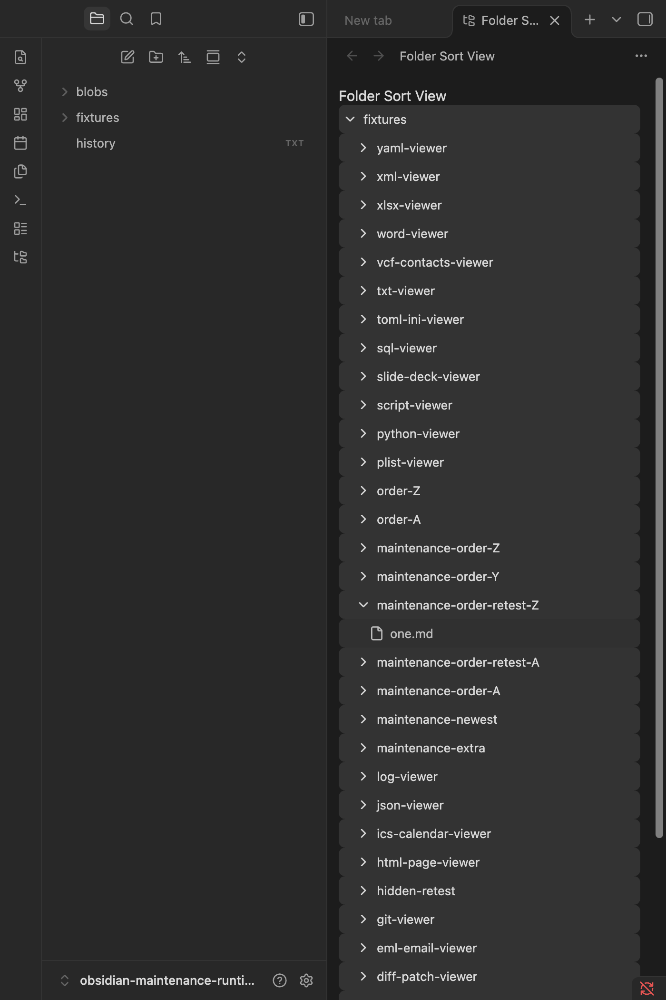
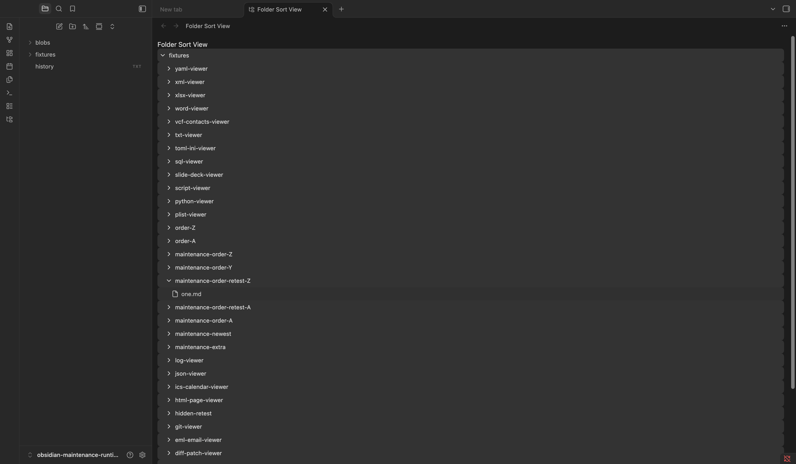

# Obsidian 1.15.1 verification — 16 November 2026

Maintenance patch `0.1.5` explicitly aligns tree rows with `justify-content: flex-start`. The actual desktop host exercised CSS candidate `761ddaeb28c6e6c334f352da12947499f64db863` with exact source, bundle, manifest and CSS hashes. Production main.js SHA-256: `b94e732d99780f9aa813148b673c7b107ee1524e24c7b335ca55c4913eeab21e`.

The earlier functional run on `8ae8922fb80faa87ecb686f4a87c0921aa88745a` checked descending folder order, expansion, actual synthetic vault create/rename/delete events, correct note opening, unchanged authored input bytes, command/view unregistration and reload. The final CSS candidate preserves that TypeScript, production bundle and manifest byte-for-byte.

The final candidate was exercised separately at emulated application viewports of 700×1050 and 1800×1050. An inline centered negative control reproduced the displaced root content; removing the control restored start alignment and measured 14px depth steps. Collapse/re-expand, correct note opening, source preservation, unload and reload passed again with the exact new CSS.

Tests use fictional fixtures in an own synthetic vault on macOS arm64, actual Obsidian 1.15.1 and Electron 39.8.3. A bounded bootstrap separates the CLI socket and test profile. Mock keychain is enabled; ordinary CLI ownership, socket inode, version response and original application bytes remained intact before/during/after the run. The own host and children were confirmed stopped. Own windows may be visible and remain unfocused; no OS mouse or keyboard input is used.

Locked install, TypeScript, production build, existing tests, retained repository lint guards, official Obsidian lint and production dependency audit passed. Generated test artifacts are outside the official production-source lint scope.

The view's DOM controls and synthetic vault event handling were tested. This does not establish native window resizing, narrow pane/container behavior, mobile, minimum-version, authentication or real keychain behavior. Fresh Community catalog installation and official source/release scans are separate publication gates.

